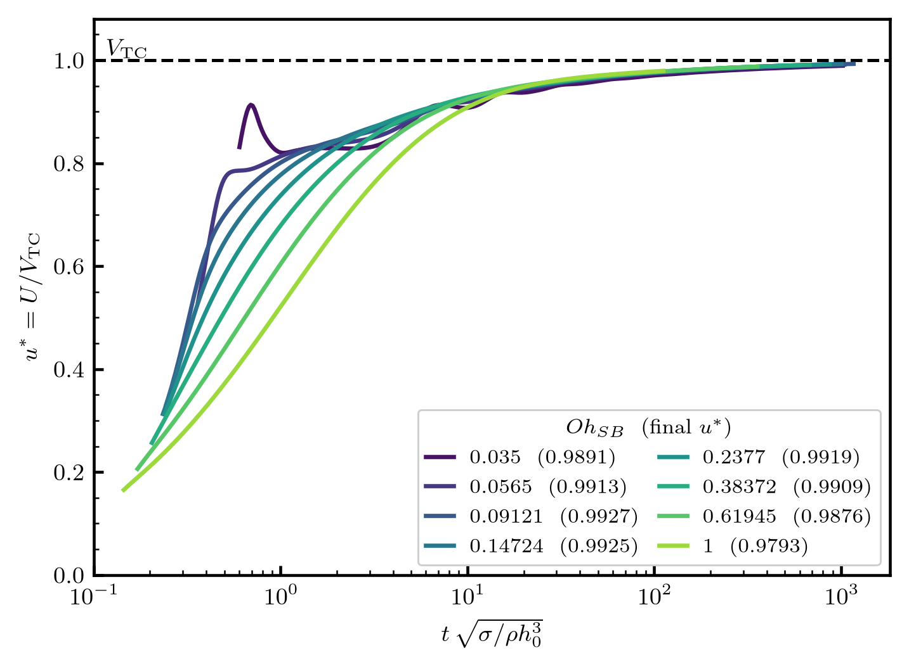
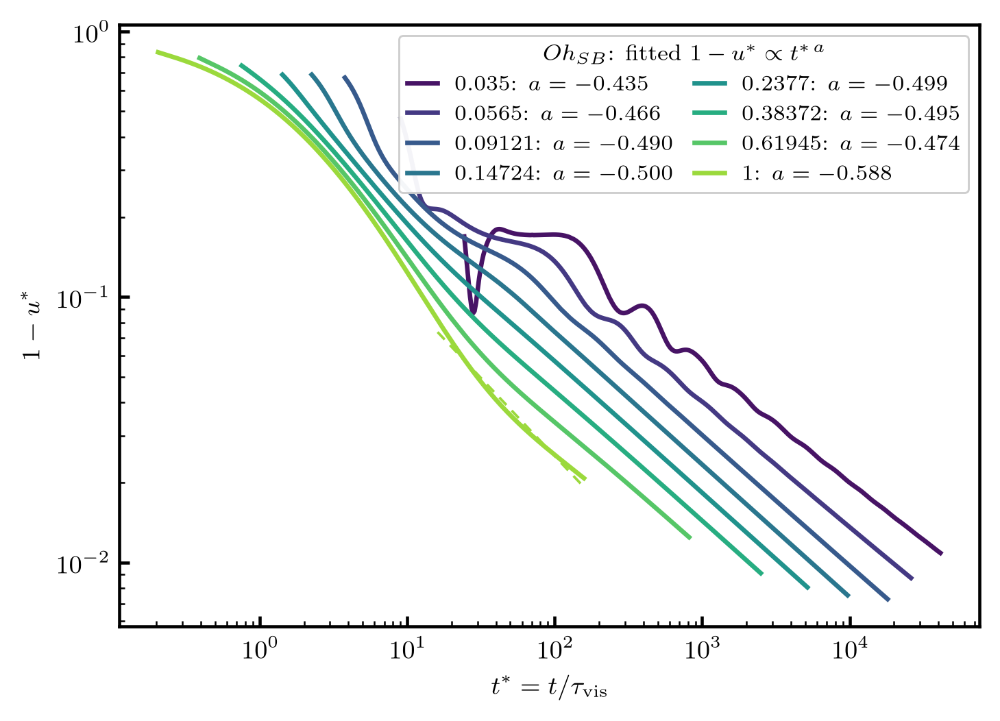
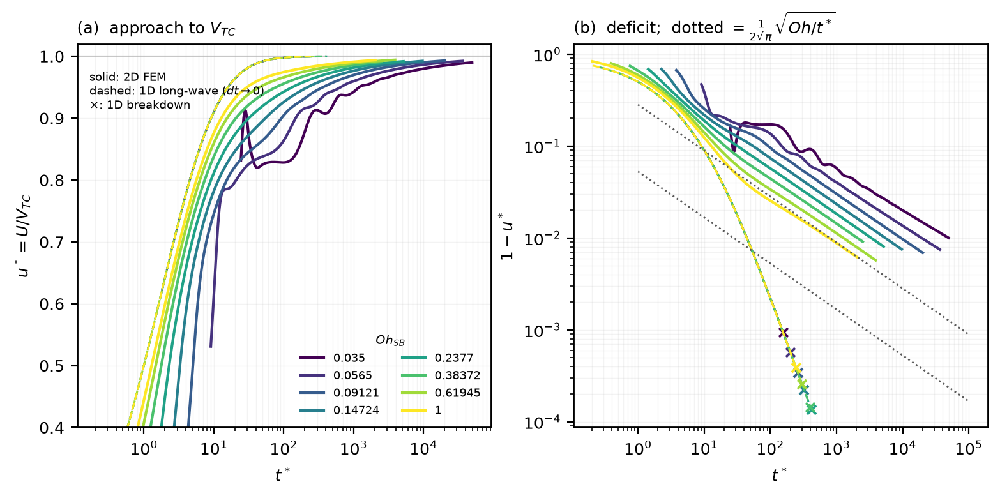

# Newtonian Taylor–Culick retraction at arbitrary Ohnesorge number

A sharp-interface finite-element campaign measuring the retraction velocity
`v(t)` of a Newtonian liquid sheet across the Ohnesorge range, and its approach
to the Taylor–Culick velocity.

This document is intended as an extension of Appendix A of

> V. Sanjay, U. Sen, P. Kant & D. Lohse, *Taylor–Culick retractions and the
> influence of the surroundings*, **J. Fluid Mech. 948** (2022) A14.
> [arXiv:2202.13400](https://arxiv.org/abs/2202.13400)

which treats the classical retraction at a single film Ohnesorge number
(`Oh_f = 0.05`). Here the same problem is swept over `Oh`, and the numerical
method is different in kind: that study used a two-phase volume-of-fluid
calculation in Basilisk C, whereas this one uses a **single-phase, sharp-interface
finite-element method in a frame co-moving with the rim**, built on
[pyoomph](https://github.com/comphy-lab/pyoomph).

**Status.** The method, the convergence evidence and the comparison against
Savva & Bush are settled and are reported below. The production sweep is
mid-flight; §7 states exactly what is and is not established.

---

## 1. Problem

A semi-infinite planar liquid sheet of uniform thickness `h0`, initially at
rest, retracts under its own surface tension `σ`. Surface tension pulls the
free edge back; the collected mass accumulates in a growing rim. There is no
surrounding gas: the interface is a true free surface with a stress condition
on it, not an interface between two resolved fluids.

Taylor (1959) and Culick (1960) predicted the terminal retraction velocity by
balancing the capillary pull against the rate of momentum gain of the rim,

```
2σ = ρ h0 V_TC²          ⇒     V_TC = sqrt( 2σ / (ρ h0) ).
```

The velocity is set by a *global* momentum budget, so it is independent of
viscosity. Viscosity controls only *how* the sheet approaches `V_TC` — and how
long it takes.

**Figure 1** shows the computational setup.


*Figure 1. Planar sheet of thickness `h0` retracting to the left. The
computation is performed in a frame co-moving with the rim: the tip is pinned
at the origin and the frame velocity `U(t)` is promoted to a global unknown.
The far field enters at `-U` through a Lagrange-multiplier (`EnforcedDirichlet`)
condition. Only the upper half is solved; the midplane is a symmetry line. At
low `Oh` a train of decaying capillary waves runs ahead of the rim. The sheet
outline is not a sketch: it is a computed interface, `Oh_SB = 0.035` at
`t ≈ 15`, so the rim proportions and the wave train are the real ones.*

---

## 2. Non-dimensionalisation, and a warning about conventions

Three conventions appear in this literature and they do not agree. Getting this
wrong moves the answer by exactly `√2`, which is large enough to look like
physics. This section is the single most useful part of the document.

**This code** scales on the **full** thickness `h0`, the density `ρ` and the
surface tension `σ`, so that `ρ = σ = h0 = 1` and the half-thickness is `0.5`:

| quantity | scale |
|---|---|
| length | `h0` |
| velocity | `sqrt(σ / (ρ h0))` |
| time | `sqrt(ρ h0³ / σ)` |
| Ohnesorge | `Oh = μ / sqrt(ρ σ h0)` |

**Sanjay et al. (JFM 2022)** scale velocity on the Taylor–Culick velocity
itself and pressure on `2γ/h0`:

```
v_γ = sqrt( 2γ_sf / (ρ_f h0) ) = V_TC ,   τ_γ = sqrt( ρ_f h0³ / (2γ_sf) ) ,
Oh_f = η_f / sqrt( ρ_f (2γ_af) h0 ) .
```

**Savva & Bush (JFM 2009)** use the same velocity scale and the same Ohnesorge
definition, but a **viscous** clock:

```
u_c = sqrt( 2γ / (ρ H) ) = V_TC ,   Oh_SB = μ / sqrt( 2 H ρ γ ) ,
τ_vis = μ H / (2γ) ,   t* = t / τ_vis .
```

with `H` the full thickness, so `H ≡ h0`.

**The map.** Sanjay et al. and Savva & Bush share an identical Ohnesorge
convention. This code differs from both by `√2`:

```
Oh_SB  =  Oh_f  =  Oh_code / √2            Oh_code = √2 · Oh_SB
```

so the coded `Oh = 0.05` used to match the Basilisk study is `Oh_SB = 0.035`.
In code units, `τ_vis = μ/2 = Oh_code/2 = Oh_SB/√2`.

> **Throughout this document `Oh` means `Oh_SB`**, the Savva & Bush / JFM
> convention, because that is what the published comparison curves use. The
> code takes `--oh` in the same convention and converts internally.

The velocity is reported as `u* = U / V_TC`, which is directly comparable
across all three conventions and tends to 1.

---

## 3. Numerical framework

### 3.1 Governing equations

Incompressible Navier–Stokes in the liquid only,

```
ρ ( ∂v/∂t + v·∇v ) = -∇p + ∇·( 2 μ D ) ,      ∇·v = 0 ,
```

with the free surface carrying the stress condition `(-p I + 2 μ D)·n = σ κ n`.
There is no gas phase, hence no density ratio, no viscosity ratio, no diffuse
interface and no spurious-current budget to defend. This is the principal
methodological difference from the Basilisk study, which resolves both phases
with a VoF tracer and a Brackbill surface-tension force.

### 3.2 The co-moving frame

The retraction path is long — the tip travels `~V_TC · t` — so a laboratory-frame
domain must be large enough to contain the entire excursion. The Basilisk study
handled that with a domain 100 `h0` wide.

Here the rim velocity is instead promoted to a **single global degree of
freedom** `U(t)`, fixed by a Lagrange multiplier that pins the tip at the
origin. The far field enters at `-U`. The mesh then only has to cover a window
around the rim, and `U(t)` is itself the physical observable: it is the
retraction velocity, and it should approach `V_TC`.

This makes the discrete system a **bordered** one — a single scalar unknown
coupled to an entire boundary — which is why the framework matters: pyoomph
derives those coupling terms symbolically rather than by hand.

Two pyoomph traps are load-bearing here and are documented in the repository's
`AGENTS.md`:

- a boundary value depending on an unknown must use `EnforcedDirichlet`, never
  `DirichletBC`;
- in axisymmetry the `2πr` measure makes any point constraint on the axis
  integrate to exactly zero, so the tip constraint there needs a Cartesian
  coordinate system or an integral form.

Neither error raises anything. Both return a plausible, wrong number.

### 3.3 Domain size

The window must contain the viscous footprint `sqrt(4 ν t)`, which grows with
`μ`, so the required window grows with `Oh`:

| `Oh_SB` | required `L/h0` at `t* = 100` |
|---|---|
| 0.035 | 13 |
| 0.5 | 52 |
| 1 | 104 |
| 5 | 300 |
| 10 | 600 |

**The campaign is bounded at `Oh_SB ≤ 1`.** Beyond that the cost grows sharply
for the least interesting physics — the strongly viscous limit where no rim
forms and the curves collapse. `Oh_SB ~ 1` is where inertia and viscosity are
comparable and the dynamics are richest.

In production the window is sized per case as

```
L = 1.25 · max( 3·sqrt(4 ν t) ,  1.6 × measured disturbance front ,  2.5 × rim radius )
```

The third term binds at low `Oh`, where the rim grows to `R ~ 52` and a
diffusive rule alone would give a window barely twice the rim.

### 3.4 Time integration — and a trap worth knowing

The solver uses BDF2 with adaptive time stepping. **However**, `maxstep` is
clamped to the current output interval and the temporal-error estimator reports
`~1e-12` against a `1e-3` tolerance, so the tolerance never binds and the step
sits on that cap on every step.

**The number of output points therefore sets the timestep**, and with it both
the cost and the temporal accuracy of a run. This is exposed as `--n-outputs`
(it was hardcoded at 400 until commit `aae8255`). §6.3 quantifies how much it
actually matters — the answer is reassuring, but the coupling is real and easy
to trip over on a restart.

---

## 4. Phenomenology across `Oh`


*Figure 2. Velocity magnitude (upper half) and viscous dissipation rate
`ε = 2μ D:D` (lower half) at a common inertio-capillary time `t ≈ 25`, over a
factor-29 range in `Oh`. Distances are from the pinned tip in units of `h0`;
the sheet is mirrored about the midplane and the free surface is drawn over
both halves. Velocity is in the **laboratory** frame — the co-moving solution
shifted by `U(t)` — so the undisturbed film reads zero and the rim reads `≈ 1`.
Both colour scales are **shared across the panels**, which is the point: a
per-panel rescale would hide the `Oh` dependence the figure exists to show.
The dissipation reconstruction is one order lower than the P2 velocity field
(see `postProcess/animate_planar.py`), so it is visualisation-grade.*

The sequence shows the whole story:

- **`Oh = 0.035` (inertial).** A well-defined, nearly circular rim connected to
  the film by a distinct neck, with a train of **decaying capillary waves**
  running ahead of it. Savva & Bush note that such waves are generated ahead of
  the rim for `Oh < 0.1`; their presence here is an independent confirmation
  that the feature is physical and not a numerical artefact.
- **`Oh = 0.2377`.** The rim is still compact, but the waves have essentially
  gone — viscosity damps them within a thickness or two of the neck.
- **`Oh = 0.61945`.** The neck has washed out; the rim merges smoothly into a
  long relaxation region.
- **`Oh = 1`.** No distinct rim at all. The sheet simply thickens over a broad
  region, and the collected mass is spread over many thicknesses.

Note that the rim height at fixed `t` is remarkably insensitive to `Oh` (all
four peak near `3 h0`), because the mass collected is set by the retraction
velocity, which is itself `Oh`-independent. What changes is how that mass is
*distributed* — and, in the lower halves, where the energy goes. At
`Oh = 0.035` dissipation is confined to the neck and to the capillary-wave
train, both of them thin; by `Oh = 1` it fills the whole thickened region and
there is no localised structure left to speak of.

---

## 4a. The retraction velocity

`u*(t) = U/V_TC` is the observable the whole campaign exists to measure, and
the eight-point log-spaced sweep is the measurement.



*Figure 3. Recovered control velocity `u* = U/V_TC` against the
inertio-capillary clock for the eight-point sweep, `Oh_SB = 0.035` to `1`. The
time axis is logarithmic because the solver writes on a geometric output
schedule. Legend gives the final `u*` reached by each case. Two features are
physical, not numerical: the low-`Oh` overshoot near `t ≈ 0.7`, where the rim
first forms and briefly outruns its own quasi-steady value, and the ripples at
`Oh ≤ 0.1` and late time, which are the capillary-wave train beating against
the rim.*

Every case is still climbing at the end of its record. None reached the
`u* = 0.995` target the sweep was sized for; the sweep was stopped at
`u* ≈ 0.979–0.993` to settle the timestep question of §6.3 first.



*Figure 4. The same data as the gap `1 - u*` against the viscous clock
`t* = t/τ_vis`, on log-log axes. Dashed lines are least-squares fits over the
last decade of each record; the fitted exponent `a` in `1 - u* ∝ t*^a` is given
per case.*

Figure 4 is the reason a single global fit is not usable. The exponent runs
from `-0.435` at `Oh_SB = 0.035` to `-0.588` at `Oh_SB = 1` and is **not**
monotone in between — `Oh_SB = 0.61945` fits `-0.474`, out of order with its
neighbours. That case has the second-shortest record in `t*` and is still in
the crossover from the inertial transient when its last decade begins, so the
non-monotonicity is most likely a fit-window artefact rather than physics. It
is left visible rather than smoothed away, because the honest statement is
that the exponent is `≈ -0.5` across the middle of the sweep and the two ends
are not yet resolved well enough to argue about.

---

## 5. The 1D reduced-order model

Savva & Bush's analysis is a long-wave (lubrication/Trouton) reduction of the
same problem. The repository carries an independent implementation so that a
disagreement with their published figures can be attributed to digitisation,
model, or code.

`simulationCases/trouton1d_pyoomph.py` solves the Trouton slender-sheet
equations in a Lagrangian mass coordinate on a graded 1D mesh clustered at the
tip, closing the tip with the massless-cap condition. It reproduces the
early-time asymptote `u* → sqrt(t*/π)` to RMS `5.8e-4` and the exact tip growth
`h = 1 + t/(2μ)` to four decimals.

Two caveats stand, and one is serious.

**The bulk capillary term is switched off.** The argument is that Savva &
Bush's tip closure already *is* the capillary pull of the massless cap, so a
bulk `κ` term double-counts it; with the term on, `u*(t*=30) = 0.106` and the
early-time asymptote misses by RMS 1.34. That is a physical argument supported
by agreement, not a derivation, and it is equally consistent with the
mixed-formulation curvature simply being too noisy on a graded mesh.

**The 1D model is temporally unconverged.** It is forced onto **BDF1** because
BDF2 fails at its third timestep on this problem, and BDF1 is only first-order.
Its temporal error is *not* controlled by the tolerance — `temporal_error` from
`1e-3` to `1e-6` returns bit-identical answers — and halving the step moves the
answer at a clean first-order rate:

| `maxstep` | `u*(30)` | ratio |
|---|---|---|
| `t_end/200` | 0.9763811199 | |
| `t_end/400` | 0.9785433680 | |
| `t_end/800` | 0.9796327373 | 1.98 |
| `t_end/1600` | 0.9801795562 | 1.99 |
| `t_end/3200` | 0.9804534962 | 2.00 |
| `t_end/6400` | 0.9805906011 | 2.00 |

Richardson extrapolation gives **`u*(30) → 0.98073`** as `dt → 0`. Against
`0.95026` from the 2D FEM and `0.9542` from the digitised Savva & Bush curve,
the converged 1D value is **+3.2% and +2.8% high**.

An earlier report of a clean three-way agreement (0.16% / 0.25%) was an
artefact of an under-resolved timestep. **The relationship between the
long-wave model and the full Navier–Stokes solution at `Oh ~ 1` is therefore an
open question**, not a settled one. Reproduce with
`validation/trouton1d_convergence.py`.

---

## 6. Verification

### 6.1 Mesh and window

At `Oh_SB = 1`, `t* = 30`, mesh resolution (0.03 / 0.04 / 0.06) and temporal
tolerance agree to better than 0.01% — but at `L = 12` that agreement is around
`0.8191`, which is **domain-limited**. Sweeping the window:

| `L` | `u*(t* = 30)` |
|---|---|
| 12 | 0.81910 – 0.81915 |
| 16 | 0.91443 |
| 25 | 0.94942 |
| 40 | 0.95026 |
| 60 | 0.95026 |

**The window length, not the mesh, is the controlling parameter**, and it is
converged for `L ≥ 40`. This is the single easiest way to get a confidently
wrong answer on this problem: a well-converged mesh on too small a window.

### 6.2 Comparison with Savva & Bush

Converged `u*(t* = 30) = 0.95026` at `Oh_SB = 1` sits **0.41% below** the
digitised Savva & Bush figure-6 value of `0.9542`. At `Oh_SB = 0.5` the code
gives `0.9297` against their `~0.93`.

The 0.41% offset is **real**: §6.3 shows it is not a timestep artefact, and
§6.1 shows it is not a mesh or domain artefact. Whether it is digitisation
error, a long-wave modelling error, or a genuine difference between the
lubrication model and Navier–Stokes is the open question flagged in §5.

### 6.3 Timestep

Because `dt` is set by the output cadence (§3.4), the campaign values were
checked against it directly at `Oh_SB = 1`, `t* = 30`, `L = 40`:

| `--n-outputs` | `u*(30)` | difference | ratio | implied order |
|---|---|---|---|---|
| 100 | 0.9503405929 | | | |
| 200 | 0.9502772866 | `-6.331e-05` | | |
| 400 | 0.9502600436 | `-1.724e-05` | 3.67 | 1.88 |
| 800 | 0.9502529574 | `-7.086e-06` | 2.43 | 1.28 |

The first refinements are close to **second order**, as expected from BDF2 and
in sharp contrast to the clean first-order behaviour of the 1D model — but the
observed order **degrades** to ~1.3 by the finest pair. Two reasons not to read
much into that: the geometric output schedule is not a uniform `dt` refinement,
so the ratio is not a textbook convergence order; and by `nout = 800` the
differences are `7e-6`, where other error sources are comparable.

What matters for the campaign is the magnitude, and it is unambiguous. The
total spread from the coarsest schedule tested to the finest is **8.8e-5**, and
Richardson on the last pair puts the remaining change at only `2e-6`–`7e-6`
(`u*(30) → 0.95025`, taking `p = 2` or `p = 1` as bounds).

Two consequences:

1. **The campaign's `u*` values are not schedule-dependent** at any level that
   matters: `8.8e-5` across an eightfold refinement, against the `0.41%`
   (`3.9e-3`) offset from Savva & Bush that the campaign is trying to resolve.
   The limit agrees with the previously recorded `0.95026` to about `1e-5`.
2. Runs may therefore use a **coarse output cadence** without loss of accuracy,
   which matters because cadence is the dominant cost lever (§3.4).

Reproduce with `postProcess/`-adjacent campaign scripts, or directly:

```bash
uv run python validation/run_validation.py --oh 1.0 --tag dt200 \
    --results <run-root> --n-outputs 200 \
    --tstar-end 30.0 --length 40.0 --resolution 0.06 --temporal-error 0.001
```

---

## 6.4 The 1D long-wave model against the 2D FEM

The 1D reduced-order model of §5 exists to be compared against the full
Navier–Stokes solution. That comparison is now done, at all eight sweep `Oh`,
and it has three results — one of which makes the naive version of the
comparison impossible.

**The 1D model is universal in `t*`; the 2D solution is not.** Extrapolated to
`dt → 0`, the 1D solver returns the *same* `u*(t*)` at every Ohnesorge number to
five decimal places:

| `t*` | 1 | 3 | 10 | 30 | 100 |
|---|---|---|---|---|---|
| 1D, any `Oh_SB` | 0.50058 | 0.72368 | 0.90992 | 0.98071 | 0.99779 |
| 2D, `Oh_SB = 1` | 0.44407 | 0.68507 | 0.87608 | 0.95026 | 0.97457 |
| 2D, `Oh_SB = 0.14724` | — | 0.45430 | 0.78218 | 0.87018 | 0.92618 |
| 2D, `Oh_SB = 0.035` | — | — | — | 0.89460 | 0.82835 |

The spread across `Oh` in the 1D rows is under `3 × 10⁻⁵`, i.e. at the level of
the extrapolation itself. This is a property of the model rather than a
coincidence: once time is measured in `τ_vis = μH/(2γ)`, the Ohnesorge number
scales out of the long-wave equations entirely. The 2D solution retains a strong
`Oh` dependence at every time — a factor of two in `1 - u*` between
`Oh_SB = 0.035` and `1` at `t* = 30`. **A one-parameter family cannot be
reproduced by a model that has collapsed that parameter away**, so the
disagreement is structural, not a matter of tuning.

Two consistency checks confirm the pipeline rather than the physics: the
extrapolated 1D value `u*(30) = 0.98071` reproduces the independently recorded
`0.98073` of §6.3, and the 2D value `0.95026` reproduces §6.2.

**The asymptotic decay laws differ in exponent, not just prefactor.** Fitting
`1 - u* = C t*^a` over the last half of each record:

| | `a` | behaviour |
|---|---|---|
| 2D FEM | `-0.490` to `-0.500` (five cases) | `1 - u* = (1/2√π)√(Oh_SB/t*)` |
| 1D long-wave | `-1.95` to `-2.01` (six cases) | `1 - u* ∝ t*⁻²` |

The 1D deficit therefore collapses far faster than the true one, and the
*relative* error grows without bound: the two curves are not offset, they
diverge. The 1D exponent is stable across `Oh_SB = 0.09121 … 1`; at `0.0565` and
`0.035` the Richardson correction exceeds the deficit being corrected, so no
exponent is quoted there and figure 3 draws the finest measured level instead of
the extrapolation.

**The 1D solver did not survive to the asymptotic regime, and the reason was a
discretisation defect rather than the model's physical limit.** Every run in the
first sweep terminated with Newton stalled at its iteration cap, residual frozen
between `4 × 10⁻⁴` and `1.5 × 10⁻³`, at rim thicknesses `h_tip` of `62`
(`Oh_SB = 1`) to `337` (`0.035`). The termination was not a timestep artefact —
at `Oh_SB = 0.38372`, `nsteps = 169242`, `338485`, `676971` all stopped at
`t* = 431`, `405`, `405` — and not a nonlinear-solver artefact, since a retry
with the Newton cap at 40 and a globally convergent line search stopped in the
same place.

It was the auxiliary block. In the original 4-field formulation `(h, u, p, κ)`,
setting `with_capillarity=False` leaves `κ` out of the momentum residual and
uses `p` only inside `κ`, so both became a one-way downstream projection that
could not influence `h` or `u` — while still sitting in the same Newton system
and setting the convergence test. The evidence is direct: the residual goes
**bit-identical** across Newton steps 7–10 and stays unchanged while the
controller halves `dt` some forty times down to `9.3 × 10⁻¹³`. A residual
invariant under `dt → 0` cannot belong to a row containing `∂ₜ`, so the stall
was in the algebraic `p` and `κ` rows.

Those rows were unsolvable in floating point. On the failure profiles `κ`
reaches `8.6 × 10³`–`4.9 × 10⁵` as a sign-alternating node-to-node mode where
the physical curvature is `O(1/h) ≈ 0.016`, and `∂κ_expr/∂p` is
`6.3 × 10⁵`–`2.4 × 10⁶` against a `κ`-row diagonal of `O(dm) = 1.9 × 10⁻⁴` — a
`10⁹`–`10¹⁰` scaling disparity inside an otherwise `O(1)` system, which puts the
Newton update below the accuracy floor of the linear solve. That is why more
iterations and a line search bought nothing: neither can rescue an update that
is itself inaccurate.

Savva & Bush met the same pathology and designed around it. They integrate on a
**staggered** mesh and note explicitly (Appendix, p. 238) that *"implementation
with a non-staggered grid introduced spurious oscillations in the curvature in
the long time limit"*. They report no stiffness limit and no maximum rim
thickness — they simply stop at `t* = 30`, reaching `h_m/H ≈ 9`. Our failures
were at `t* = 245`–`1348` and `h_tip = 62`–`337`, i.e. 8–45× beyond their
integration horizon and 7–37× their largest rim.

**Fix.** `p` and `κ` are now unknowns only when `with_capillarity=True`
(`simulationCases/trouton1d_pyoomph.py`). The 2-field `(h, u)` system reproduces
`u*(30) = 0.9805907141` **bit-identically**, as it must, since the removed
fields could not influence the solution. Two further items are known and not yet
acted on: `h` carries a genuine vertex/midside checkerboard on `C2` elements
(the mass residual is a pointwise ODE with no spatial operator on `h`, so
nothing damps the odd/even mode), reaching 65% relative amplitude at
`Oh_SB = 0.035`; and refinement makes the failure *earlier*, not later, which is
the signature of a mesh-scale parasitic mode and means `h`-adaptivity is the
wrong lever.

The results reported above were computed with the original 4-field solver and
therefore end where it stopped. **They are not invalidated** — the extrapolated
`u*(t*)` values reproduce the independently recorded `0.98073`, and the removed
fields provably cannot affect `h` or `u` — but the asymptotic reach of the 1D
model is an open question again rather than a settled limit.

**A caution on slenderness.** It is tempting to read the breakdown as the
long-wave assumption failing. The rim aspect ratio `h_tip/L_rim` crosses 1 at
`t* ≈ 0.2`–`4` in every case, i.e. essentially immediately, and reaches
`23`–`2113` at the old failure points. So slenderness is violated from the start,
long before anything breaks, and cannot serve as the stopping criterion. Savva &
Bush say as much (p. 223): the equations *"become singular as we approach the
film tip… nevertheless, such models perform surprisingly well"*. A defensible
pre-registered horizon is instead `t* = 100`, about 3× beyond their published
range and well past `u* = 0.99`.



*Figure 3. Solid: 2D co-moving FEM. Dashed: 1D long-wave model extrapolated to
`dt → 0`; dotted where the Richardson correction exceeds the deficit and the
finest measured level is shown instead. `×` marks the 1D breakdown. (a) the
approach to `V_TC`; every 1D curve lies on top of every other, because `Oh`
scales out of the long-wave equations. (b) the deficit `1 - u*`; the grey dotted
reference lines are `(1/2√π)√(Oh/t*)` at `Oh_SB = 0.035` and `1`. The 1D deficit
falls as `t*⁻²` and leaves the physical law rather than approaching it.*

Regenerate with:

```bash
uv run python postProcess/compare_1d_2d.py --json-out /tmp/cmp.json
```

---

## 7. What is and is not established

**Established.**

- The co-moving formulation, and that the window (not the mesh) controls the
  answer, converged for `L ≥ 40` at `Oh_SB = 1`.
- `u*(t*=30) = 0.95026` at `Oh_SB = 1`, converged in mesh, window and timestep.
- A 0.41% offset from the digitised Savva & Bush value that is not numerical.
- Temporal error below `1e-4` across an eightfold change in output cadence,
  so the campaign may be run at a coarse cadence.
- The phenomenological sequence of figure 2 across a factor 29 in `Oh`.
- **The long-time limit.** `v(t → ∞) = V_TC` at every `Oh`, approached
  diffusively as

  ```
  1 - u*(t*)  =  (1 / 2√π) · √(Oh_SB / t*)
  ```

  Five cases spanning a factor 6.8 in `Oh` sit within 1% of the constant
  `1/(2√π) = 0.28209` — `0.2837`, `0.2823`, `0.2816`, `0.2813`, `0.2793` at
  `Oh_SB = 0.14724`, `0.2377`, `0.38372`, `0.61945`, `1.0` — with the measured
  exponent at `-0.4901` to `-0.4998` against the predicted `-1/2`. There is no
  `Oh`-dependent asymptotic deficit: viscosity sets *how slowly* `V_TC` is
  reached, not *what* is reached. This supersedes the earlier reading of the
  exponent as non-constant across the sweep; that was measured on records too
  short at both ends of the `Oh` range, not a real drift.
- **The 1D long-wave model is universal in `t*` and the 2D solution is not**
  (§6.4), so the two cannot agree across `Oh` in principle. The 1D deficit falls
  as `t*⁻²` against the true `t*⁻¹ᐟ²`.

**Not established.**

- The onset of the asymptotic regime. The three lowest `Oh` are still outside
  it: `C√Oh = 0.2945`, `0.3340`, `0.4072` at `Oh_SB = 0.09121`, `0.0565`,
  `0.035`, i.e. `+4%`, `+18%`, `+44%`, with exponents `-0.487`, `-0.457`,
  `-0.429`. The trend is monotone in `Oh` and consistent with an onset time that
  grows as `Oh` falls, but the scaling of that onset is **not** measured, and
  reaching it at `Oh_SB = 0.035` needs one to two decades more `t*` than the
  hardware delivered.
- Whether `1/(2√π)` is exact. Five cases agreeing to within 1% is suggestive of
  a closed form, not proof of one; no derivation is offered here.
- How far the 1D model reaches once its auxiliary block is removed. The
  `h_tip ≈ 62–337` breakdown is now understood as a discretisation defect and
  fixed (§6.4); the new asymptotic reach has not yet been measured. A second,
  untouched defect remains: `h` carries a vertex/midside checkerboard on `C2`
  elements that grows to 65% relative amplitude at `Oh_SB = 0.035`.
- Anything at `Oh_SB > 1`, which is deliberately out of scope (§3.3).

---

## 8. Reproducing the campaign

Environment (`uv` owns it; pyoomph is a pinned source build):

```bash
uv sync
```

A single case:

```bash
uv run python validation/run_validation.py \
    --oh 1.0 --tag demo --results <run-root> \
    --tstar-end 30.0 --length 40.0 --resolution 0.06 \
    --temporal-error 0.001 --n-outputs 400 --checkpoint-every 20
```

Restarting from a checkpoint — note that `--n-outputs` should be **scaled down**
to preserve the original cadence, or the run silently does 5–10× more work; the
runner warns and prints the matched count:

```bash
uv run python validation/run_validation.py --oh 1.0 --tag demo \
    --results <run-root> --n-outputs 41 ... \
    --restart-from <run-root>/Oh_SB_1_demo/checkpoints/ckpt_0320.dump
```

Convergence studies:

```bash
uv run python validation/trouton1d_convergence.py --study all   # 1D, all three
```

Figures and animations:

```bash
# All four docs figures. --sweep and --archive point at the run roots; any
# case that is not mounted is skipped with a warning. --only takes a subset.
uv run python postProcess/make_docs_figures.py --out docs/figures

# Production animation: whole domain on top, centred u*(t) underneath.
uv run python postProcess/animate_stacked.py \
    --case-dir <run-root>/Oh_SB_0.2377_u995 \
    --out Oh_SB_0.23770_u995_stacked.mp4 --nframes 240 --procs 8
```

`animate_stacked.py` reads `case.json` for the viscosity and the domain
length, so the only positional input is the case directory. For a case whose
`liquid.pvd` was truncated by a restart, pass the launcher log to
`--reconstruct` and the index-to-time map is rebuilt from its `OUTPUT at t=`
lines.

**Simulation data is not in this repository.** Runs write to the project run
root on the compute host; custody is recorded in the project tracker. The
figure script takes `--sweep` and `--archive` paths and skips any case whose
data is not mounted.

### Known operational defects

- `control.txt` is **truncated** on restart, and checkpoint numbering restarts
  at `ckpt_0020`. Preserve the pre-restart copies and concatenate in
  post-processing. Note that for the three restarted sweep cases
  `control_part1.txt` runs *further* in time than the post-restart
  `control.txt` does, because the restart resumed from an earlier checkpoint —
  so neither file alone is the trajectory. `postProcess/animate_stacked.py`
  exposes `load_control()`, which merges them.
- **`liquid.pvd` is truncated the same way, and the VTUs are worse.** The
  post-restart run rewrites `liquid_000000.vtu` upward, so on those cases the
  low-index files no longer hold the pre-restart state and the collection file
  no longer indexes the surviving high-index ones. The times are recoverable:
  the launcher log prints `OUTPUT at t=` once per emitted VTU in order, and
  that series was checked against an intact `liquid.pvd` and matched exactly
  (max difference `0.0` over 2120 entries). `animate_stacked.py --reconstruct
  <log>` does the rebuild. Affects `Oh_SB = 0.0565`, `0.09121` and `0.14724`;
  the other five sweep cases were never restarted and are intact.
- PARDISO accepted solves with large backward error on the highest-`Oh` cases
  (`repair_bad_solves` is off). The recorded `u*` trajectories are strictly
  monotone with no jumps, so Newton recovered, but treat `Oh ≥ 0.38` as
  carrying that caveat.
- Memory is dominated by the direct sparse factorisation at roughly
  **10.5 kB/dof** (PARDISO). It scales with `ndof`, not with the number of
  timesteps.

---

## 9. References

- G. I. Taylor, *The dynamics of thin sheets of fluid. III. Disintegration of
  fluid sheets*, Proc. R. Soc. A **253** (1959) 313–321.
- F. E. C. Culick, *Comments on a ruptured soap film*, J. Appl. Phys. **31**
  (1960) 1128–1129.
- N. Savva & J. W. M. Bush, *Viscous sheet retraction*, J. Fluid Mech. **626**
  (2009) 211–240.
- V. Sanjay, U. Sen, P. Kant & D. Lohse, *Taylor–Culick retractions and the
  influence of the surroundings*, J. Fluid Mech. **948** (2022) A14.
- C. Diddens & D. Rocha, *Bifurcation tracking on moving meshes and with
  consideration of azimuthal symmetry breaking instabilities*,
  [arXiv:2312.11416](https://arxiv.org/abs/2312.11416) — the pyoomph method.
- M. Heil & A. L. Hazel, *oomph-lib – an object-oriented multi-physics
  finite-element library*, in Fluid–Structure Interaction (2006) 19–49.
