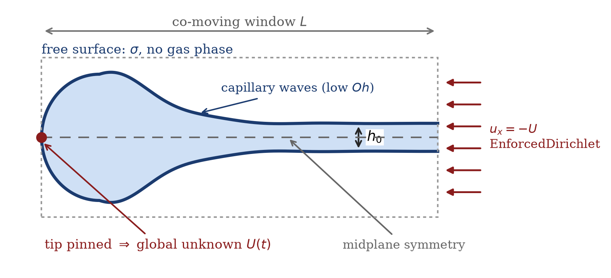
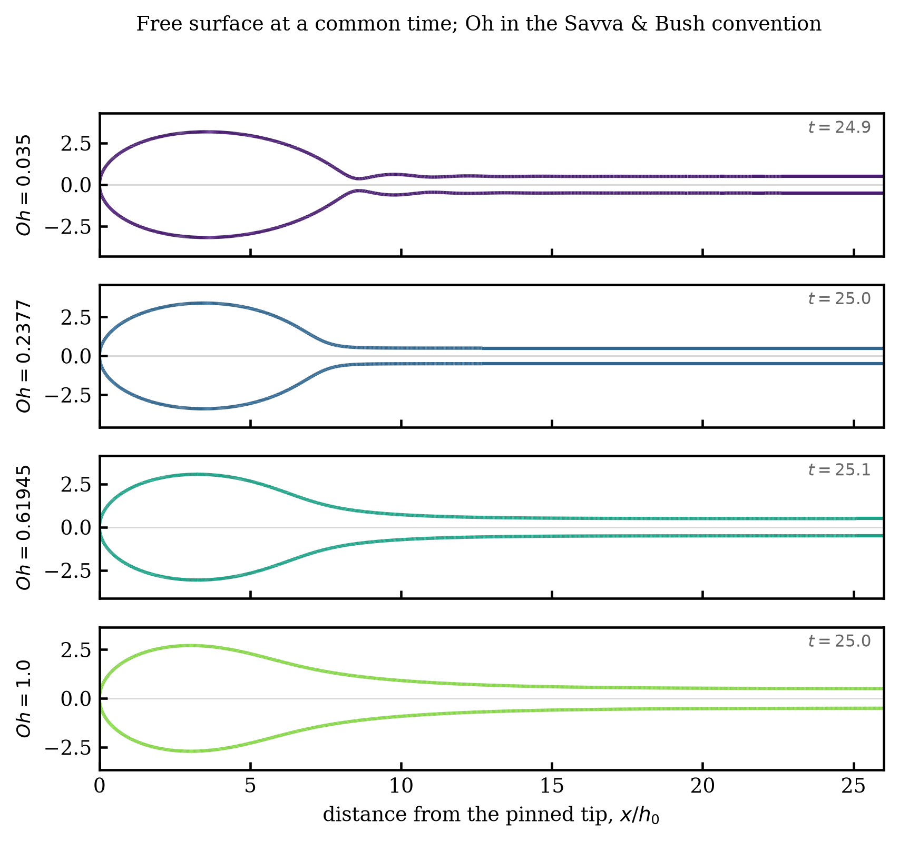

# Newtonian Taylor–Culick retraction at arbitrary Ohnesorge number

A sharp-interface finite-element campaign measuring the retraction velocity
`v(t)` of a Newtonian liquid sheet across the Ohnesorge range, and its approach
to the Taylor–Culick velocity.

This document is intended as an extension of Appendix A of

> V. Sanjay, U. Sen, P. Kant & D. Lohse, *Taylor–Culick retractions and the
> influence of the surroundings*, **J. Fluid Mech. 948** (2022) A14.
> [arXiv:2202.13400](https://arxiv.org/abs/2202.13400)

which treats the classical retraction at a single film Ohnesorge number
(`Oh_f = 0.05`). Here the same problem is swept over `Oh`, and the numerical
method is different in kind: that study used a two-phase volume-of-fluid
calculation in Basilisk C, whereas this one uses a **single-phase, sharp-interface
finite-element method in a frame co-moving with the rim**, built on
[pyoomph](https://github.com/comphy-lab/pyoomph).

**Status.** The method, the convergence evidence and the comparison against
Savva & Bush are settled and are reported below. The production sweep is
mid-flight; §7 states exactly what is and is not established.

---

## 1. Problem

A semi-infinite planar liquid sheet of uniform thickness `h0`, initially at
rest, retracts under its own surface tension `σ`. Surface tension pulls the
free edge back; the collected mass accumulates in a growing rim. There is no
surrounding gas: the interface is a true free surface with a stress condition
on it, not an interface between two resolved fluids.

Taylor (1959) and Culick (1960) predicted the terminal retraction velocity by
balancing the capillary pull against the rate of momentum gain of the rim,

```
2σ = ρ h0 V_TC²          ⇒     V_TC = sqrt( 2σ / (ρ h0) ).
```

The velocity is set by a *global* momentum budget, so it is independent of
viscosity. Viscosity controls only *how* the sheet approaches `V_TC` — and how
long it takes.

**Figure 1** shows the computational setup.



*Figure 1. Planar sheet of thickness `h0` retracting to the left. The
computation is performed in a frame co-moving with the rim: the tip is pinned
at the origin and the frame velocity `U(t)` is promoted to a global unknown.
The far field enters at `-U` through a Lagrange-multiplier (`EnforcedDirichlet`)
condition. Only the upper half is solved; the midplane is a symmetry line. At
low `Oh` a train of decaying capillary waves runs ahead of the rim.*

---

## 2. Non-dimensionalisation, and a warning about conventions

Three conventions appear in this literature and they do not agree. Getting this
wrong moves the answer by exactly `√2`, which is large enough to look like
physics. This section is the single most useful part of the document.

**This code** scales on the **full** thickness `h0`, the density `ρ` and the
surface tension `σ`, so that `ρ = σ = h0 = 1` and the half-thickness is `0.5`:

| quantity | scale |
|---|---|
| length | `h0` |
| velocity | `sqrt(σ / (ρ h0))` |
| time | `sqrt(ρ h0³ / σ)` |
| Ohnesorge | `Oh = μ / sqrt(ρ σ h0)` |

**Sanjay et al. (JFM 2022)** scale velocity on the Taylor–Culick velocity
itself and pressure on `2γ/h0`:

```
v_γ = sqrt( 2γ_sf / (ρ_f h0) ) = V_TC ,   τ_γ = sqrt( ρ_f h0³ / (2γ_sf) ) ,
Oh_f = η_f / sqrt( ρ_f (2γ_af) h0 ) .
```

**Savva & Bush (JFM 2009)** use the same velocity scale and the same Ohnesorge
definition, but a **viscous** clock:

```
u_c = sqrt( 2γ / (ρ H) ) = V_TC ,   Oh_SB = μ / sqrt( 2 H ρ γ ) ,
τ_vis = μ H / (2γ) ,   t* = t / τ_vis .
```

with `H` the full thickness, so `H ≡ h0`.

**The map.** Sanjay et al. and Savva & Bush share an identical Ohnesorge
convention. This code differs from both by `√2`:

```
Oh_SB  =  Oh_f  =  Oh_code / √2            Oh_code = √2 · Oh_SB
```

so the coded `Oh = 0.05` used to match the Basilisk study is `Oh_SB = 0.035`.
In code units, `τ_vis = μ/2 = Oh_code/2 = Oh_SB/√2`.

> **Throughout this document `Oh` means `Oh_SB`**, the Savva & Bush / JFM
> convention, because that is what the published comparison curves use. The
> code takes `--oh` in the same convention and converts internally.

The velocity is reported as `u* = U / V_TC`, which is directly comparable
across all three conventions and tends to 1.

---

## 3. Numerical framework

### 3.1 Governing equations

Incompressible Navier–Stokes in the liquid only,

```
ρ ( ∂v/∂t + v·∇v ) = -∇p + ∇·( 2 μ D ) ,      ∇·v = 0 ,
```

with the free surface carrying the stress condition `(-p I + 2 μ D)·n = σ κ n`.
There is no gas phase, hence no density ratio, no viscosity ratio, no diffuse
interface and no spurious-current budget to defend. This is the principal
methodological difference from the Basilisk study, which resolves both phases
with a VoF tracer and a Brackbill surface-tension force.

### 3.2 The co-moving frame

The retraction path is long — the tip travels `~V_TC · t` — so a laboratory-frame
domain must be large enough to contain the entire excursion. The Basilisk study
handled that with a domain 100 `h0` wide.

Here the rim velocity is instead promoted to a **single global degree of
freedom** `U(t)`, fixed by a Lagrange multiplier that pins the tip at the
origin. The far field enters at `-U`. The mesh then only has to cover a window
around the rim, and `U(t)` is itself the physical observable: it is the
retraction velocity, and it should approach `V_TC`.

This makes the discrete system a **bordered** one — a single scalar unknown
coupled to an entire boundary — which is why the framework matters: pyoomph
derives those coupling terms symbolically rather than by hand.

Two pyoomph traps are load-bearing here and are documented in the repository's
`AGENTS.md`:

- a boundary value depending on an unknown must use `EnforcedDirichlet`, never
  `DirichletBC`;
- in axisymmetry the `2πr` measure makes any point constraint on the axis
  integrate to exactly zero, so the tip constraint there needs a Cartesian
  coordinate system or an integral form.

Neither error raises anything. Both return a plausible, wrong number.

### 3.3 Domain size

The window must contain the viscous footprint `sqrt(4 ν t)`, which grows with
`μ`, so the required window grows with `Oh`:

| `Oh_SB` | required `L/h0` at `t* = 100` |
|---|---|
| 0.035 | 13 |
| 0.5 | 52 |
| 1 | 104 |
| 5 | 300 |
| 10 | 600 |

**The campaign is bounded at `Oh_SB ≤ 1`.** Beyond that the cost grows sharply
for the least interesting physics — the strongly viscous limit where no rim
forms and the curves collapse. `Oh_SB ~ 1` is where inertia and viscosity are
comparable and the dynamics are richest.

In production the window is sized per case as

```
L = 1.25 · max( 3·sqrt(4 ν t) ,  1.6 × measured disturbance front ,  2.5 × rim radius )
```

The third term binds at low `Oh`, where the rim grows to `R ~ 52` and a
diffusive rule alone would give a window barely twice the rim.

### 3.4 Time integration — and a trap worth knowing

The solver uses BDF2 with adaptive time stepping. **However**, `maxstep` is
clamped to the current output interval and the temporal-error estimator reports
`~1e-12` against a `1e-3` tolerance, so the tolerance never binds and the step
sits on that cap on every step.

**The number of output points therefore sets the timestep**, and with it both
the cost and the temporal accuracy of a run. This is exposed as `--n-outputs`
(it was hardcoded at 400 until commit `aae8255`). §6.3 quantifies how much it
actually matters — the answer is reassuring, but the coupling is real and easy
to trip over on a restart.

---

## 4. Phenomenology across `Oh`



*Figure 2. Free surface at a common inertio-capillary time `t ≈ 25`, over a
factor-29 range in `Oh`. Distances are from the pinned tip in units of `h0`;
the sheet is mirrored about the midplane.*

The sequence shows the whole story:

- **`Oh = 0.035` (inertial).** A well-defined, nearly circular rim connected to
  the film by a distinct neck, with a train of **decaying capillary waves**
  running ahead of it. Savva & Bush note that such waves are generated ahead of
  the rim for `Oh < 0.1`; their presence here is an independent confirmation
  that the feature is physical and not a numerical artefact.
- **`Oh = 0.2377`.** The rim is still compact, but the waves have essentially
  gone — viscosity damps them within a thickness or two of the neck.
- **`Oh = 0.61945`.** The neck has washed out; the rim merges smoothly into a
  long relaxation region.
- **`Oh = 1`.** No distinct rim at all. The sheet simply thickens over a broad
  region, and the collected mass is spread over many thicknesses.

Note that the rim height at fixed `t` is remarkably insensitive to `Oh` (all
four peak near `3 h0`), because the mass collected is set by the retraction
velocity, which is itself `Oh`-independent. What changes is how that mass is
*distributed*.

---

## 5. The 1D reduced-order model

Savva & Bush's analysis is a long-wave (lubrication/Trouton) reduction of the
same problem. The repository carries an independent implementation so that a
disagreement with their published figures can be attributed to digitisation,
model, or code.

`simulationCases/trouton1d_pyoomph.py` solves the Trouton slender-sheet
equations in a Lagrangian mass coordinate on a graded 1D mesh clustered at the
tip, closing the tip with the massless-cap condition. It reproduces the
early-time asymptote `u* → sqrt(t*/π)` to RMS `5.8e-4` and the exact tip growth
`h = 1 + t/(2μ)` to four decimals.

Two caveats stand, and one is serious.

**The bulk capillary term is switched off.** The argument is that Savva &
Bush's tip closure already *is* the capillary pull of the massless cap, so a
bulk `κ` term double-counts it; with the term on, `u*(t*=30) = 0.106` and the
early-time asymptote misses by RMS 1.34. That is a physical argument supported
by agreement, not a derivation, and it is equally consistent with the
mixed-formulation curvature simply being too noisy on a graded mesh.

**The 1D model is temporally unconverged.** It is forced onto **BDF1** because
BDF2 fails at its third timestep on this problem, and BDF1 is only first-order.
Its temporal error is *not* controlled by the tolerance — `temporal_error` from
`1e-3` to `1e-6` returns bit-identical answers — and halving the step moves the
answer at a clean first-order rate:

| `maxstep` | `u*(30)` | ratio |
|---|---|---|
| `t_end/200` | 0.9763811199 | |
| `t_end/400` | 0.9785433680 | |
| `t_end/800` | 0.9796327373 | 1.98 |
| `t_end/1600` | 0.9801795562 | 1.99 |
| `t_end/3200` | 0.9804534962 | 2.00 |
| `t_end/6400` | 0.9805906011 | 2.00 |

Richardson extrapolation gives **`u*(30) → 0.98073`** as `dt → 0`. Against
`0.95026` from the 2D FEM and `0.9542` from the digitised Savva & Bush curve,
the converged 1D value is **+3.2% and +2.8% high**.

An earlier report of a clean three-way agreement (0.16% / 0.25%) was an
artefact of an under-resolved timestep. **The relationship between the
long-wave model and the full Navier–Stokes solution at `Oh ~ 1` is therefore an
open question**, not a settled one. Reproduce with
`validation/trouton1d_convergence.py`.

---

## 6. Verification

### 6.1 Mesh and window

At `Oh_SB = 1`, `t* = 30`, mesh resolution (0.03 / 0.04 / 0.06) and temporal
tolerance agree to better than 0.01% — but at `L = 12` that agreement is around
`0.8191`, which is **domain-limited**. Sweeping the window:

| `L` | `u*(t* = 30)` |
|---|---|
| 12 | 0.81910 – 0.81915 |
| 16 | 0.91443 |
| 25 | 0.94942 |
| 40 | 0.95026 |
| 60 | 0.95026 |

**The window length, not the mesh, is the controlling parameter**, and it is
converged for `L ≥ 40`. This is the single easiest way to get a confidently
wrong answer on this problem: a well-converged mesh on too small a window.

### 6.2 Comparison with Savva & Bush

Converged `u*(t* = 30) = 0.95026` at `Oh_SB = 1` sits **0.41% below** the
digitised Savva & Bush figure-6 value of `0.9542`. At `Oh_SB = 0.5` the code
gives `0.9297` against their `~0.93`.

The 0.41% offset is **real**: §6.3 shows it is not a timestep artefact, and
§6.1 shows it is not a mesh or domain artefact. Whether it is digitisation
error, a long-wave modelling error, or a genuine difference between the
lubrication model and Navier–Stokes is the open question flagged in §5.

### 6.3 Timestep

Because `dt` is set by the output cadence (§3.4), the campaign values were
checked against it directly at `Oh_SB = 1`, `t* = 30`, `L = 40`:

| `--n-outputs` | `u*(30)` | difference | ratio |
|---|---|---|---|
| 100 | 0.9503405929 | | |
| 200 | 0.9502772866 | `-6.331e-05` | |
| 400 | 0.9502600436 | `-1.724e-05` | 3.67 |

Ratio ≈ 4 is **second-order** convergence, as expected from BDF2, and in sharp
contrast to the first-order 1D model. Richardson extrapolation gives
`u*(30) → 0.9502543`, so the entire spread from the coarsest schedule tested
down to `dt → 0` is **8.6e-5**.

Two consequences:

1. **The campaign's `u*` values are not schedule-dependent** at any level that
   matters, and the converged limit agrees with the previously recorded
   `0.95026` to `5.7e-6`.
2. Runs may therefore use a **coarse output cadence** without loss of accuracy,
   which matters because cadence is the dominant cost lever (§3.4).

Reproduce with `postProcess/`-adjacent campaign scripts, or directly:

```bash
uv run python validation/run_validation.py --oh 1.0 --tag dt200 \
    --results <run-root> --n-outputs 200 \
    --tstar-end 30.0 --length 40.0 --resolution 0.06 --temporal-error 0.001
```

---

## 7. What is and is not established

**Established.**

- The co-moving formulation, and that the window (not the mesh) controls the
  answer, converged for `L ≥ 40` at `Oh_SB = 1`.
- `u*(t*=30) = 0.95026` at `Oh_SB = 1`, converged in mesh, window and timestep.
- A 0.41% offset from the digitised Savva & Bush value that is not numerical.
- Second-order temporal behaviour, so the campaign may be run cheaply.
- The phenomenological sequence of figure 2 across a factor 29 in `Oh`.

**Not established.**

- The long-time limit `v(t → ∞)`. The production sweep targets `u* = 0.995` at
  eight log-spaced `Oh` from 0.035 to 1; the approach is a power law
  `1 - u* ∝ t*^-a` with `a` running from `-0.438` at `Oh = 0.035` to `-0.549`
  at `Oh = 1`, so the exponent is **not** constant across the sweep and a single
  global fit mis-sizes both ends.
- Why the converged 1D model sits ~3% above the 2D FEM (§5).
- Anything at `Oh_SB > 1`, which is deliberately out of scope (§3.3).

---

## 8. Reproducing the campaign

Environment (`uv` owns it; pyoomph is a pinned source build):

```bash
uv sync
```

A single case:

```bash
uv run python validation/run_validation.py \
    --oh 1.0 --tag demo --results <run-root> \
    --tstar-end 30.0 --length 40.0 --resolution 0.06 \
    --temporal-error 0.001 --n-outputs 400 --checkpoint-every 20
```

Restarting from a checkpoint — note that `--n-outputs` should be **scaled down**
to preserve the original cadence, or the run silently does 5–10× more work; the
runner warns and prints the matched count:

```bash
uv run python validation/run_validation.py --oh 1.0 --tag demo \
    --results <run-root> --n-outputs 41 ... \
    --restart-from <run-root>/Oh_SB_1_demo/checkpoints/ckpt_0320.dump
```

Convergence studies:

```bash
uv run python validation/trouton1d_convergence.py --study all   # 1D, all three
uv run python postProcess/make_docs_figures.py --out docs/figures
```

**Simulation data is not in this repository.** Runs write to the project run
root on the compute host; custody is recorded in the project tracker. The
figure script takes `--sweep` and `--archive` paths and skips any case whose
data is not mounted.

### Known operational defects

- `control.txt` is **truncated** on restart, and checkpoint numbering restarts
  at `ckpt_0020`. Preserve the pre-restart copies and concatenate in
  post-processing.
- PARDISO accepted solves with large backward error on the highest-`Oh` cases
  (`repair_bad_solves` is off). The recorded `u*` trajectories are strictly
  monotone with no jumps, so Newton recovered, but treat `Oh ≥ 0.38` as
  carrying that caveat.
- Memory is dominated by the direct sparse factorisation at roughly
  **10.5 kB/dof** (PARDISO). It scales with `ndof`, not with the number of
  timesteps.

---

## 9. References

- G. I. Taylor, *The dynamics of thin sheets of fluid. III. Disintegration of
  fluid sheets*, Proc. R. Soc. A **253** (1959) 313–321.
- F. E. C. Culick, *Comments on a ruptured soap film*, J. Appl. Phys. **31**
  (1960) 1128–1129.
- N. Savva & J. W. M. Bush, *Viscous sheet retraction*, J. Fluid Mech. **626**
  (2009) 211–240.
- V. Sanjay, U. Sen, P. Kant & D. Lohse, *Taylor–Culick retractions and the
  influence of the surroundings*, J. Fluid Mech. **948** (2022) A14.
- C. Diddens & D. Rocha, *Bifurcation tracking on moving meshes and with
  consideration of azimuthal symmetry breaking instabilities*,
  [arXiv:2312.11416](https://arxiv.org/abs/2312.11416) — the pyoomph method.
- M. Heil & A. L. Hazel, *oomph-lib – an object-oriented multi-physics
  finite-element library*, in Fluid–Structure Interaction (2006) 19–49.
