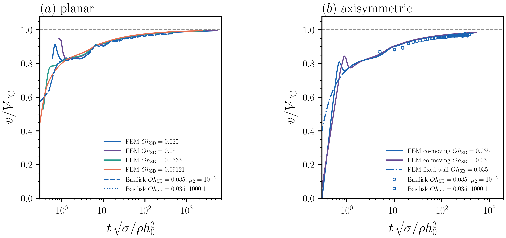

# Inertial Taylor–Culick retraction (`Oh_SB < 0.1`)

Direct free-surface Navier–Stokes in a co-moving window, compared with an
independent volume-of-fluid calculation. This is the regime in which a bulbous
rim forms and capillary waves run ahead of it (Savva & Bush 2009; Brenner &
Gueyffier 1999). The Ohnesorge number is the Savva & Bush convention,
`Oh_SB = μ / sqrt(2 h0 ρ γ)`.

The viscous-limit Trouton note is
[`../validation-viscous/`](../validation-viscous/). The four axisymmetric
solvers are checked in [`../axi-validation/`](../axi-validation/). This page
is the inertial campaign comparison, FEM against Basilisk.

## Status

Planar is closed. The co-moving FEM and the Basilisk volume-of-fluid planar
solver agree on the inertial approach to `V_TC`. FEM cases at
`Oh_SB = 0.035`, `0.05`, `0.0565` and `0.09121` collapse onto
`u* = U/V_TC → 1`, with terminal values `0.994`–`0.996`. Basilisk at
`Oh_SB = 0.035`, taken to capillary time `t = 500`, ends at `u* ≈ 0.977`.
The offset is the expected difference between a sharp free surface with no
gas and a diffuse two-phase interface. Vatsal approved this comparison on
2026-08-29.

The same comparison for a circular hole is still running. That work is not a
closed result.

*Figure. Retraction speed `u* = U/V_TC` against capillary time for
`Oh_SB < 0.1`. Left, planar sheet. FEM at four Ohnesorge numbers approaches
`u* → 1`; Basilisk at `Oh_SB = 0.035` for two liquid:gas viscosity ratios sits
slightly below, as expected for a two-phase VoF interface. Right, circular
hole, still in progress: co-moving FEM at `Oh_SB = 0.035` and `0.05`, a short
fixed-wall FEM comparison, and Basilisk at the same two viscosity ratios.*

## What closed means for planar

The planar co-moving formulation recovers a constant tip speed while the rim
keeps growing. That is the classical budget, `d(mV)/dt = 2σ` with
`m = ρ h0 V t`. The check against Basilisk is cross-method. Savva & Bush do
not reach `Oh_SB < 0.1` in the digitised figures, so the strongly inertial
end is judged against `V_TC` and against Basilisk, rather than against their
lubrication curves.

Phenomenology and the co-moving setup are in the planar campaign write-up,
[`../planar-campaign/`](../planar-campaign/), figures 1–3. Closing the
planar inertial comparison does not settle the `1/(2√π)` deficit coefficient
below `Oh_SB = 0.14724`; that question remains in §7 of that write-up.

## Conventions

Length on the full thickness `h0`, density `ρ`, surface tension `σ`. Then
`V_TC = sqrt(2)` and `Oh_SB = Oh_code / √2`. Report `u* = U/V_TC` and
capillary time `t sqrt(σ / ρ h0³)`. The viscous clock `t* = t/τ_vis` is the
wrong axis here. At `Oh_SB = 0.035`, `t* = 30` is still `t = 0.75`.

## Related code

- `simulationCases/planar_comoving.py`
- `simulationCases/axisymmetric_comoving.py`
- `validation/run_validation.py`
- `validation/run_validation_axi_comoving.py`
- `validation/inertial/README.md` (regime claim)
